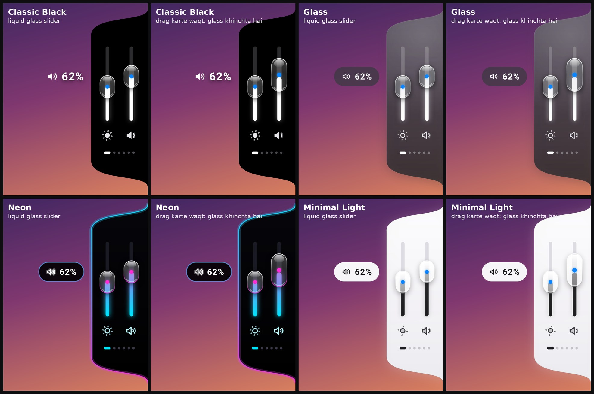
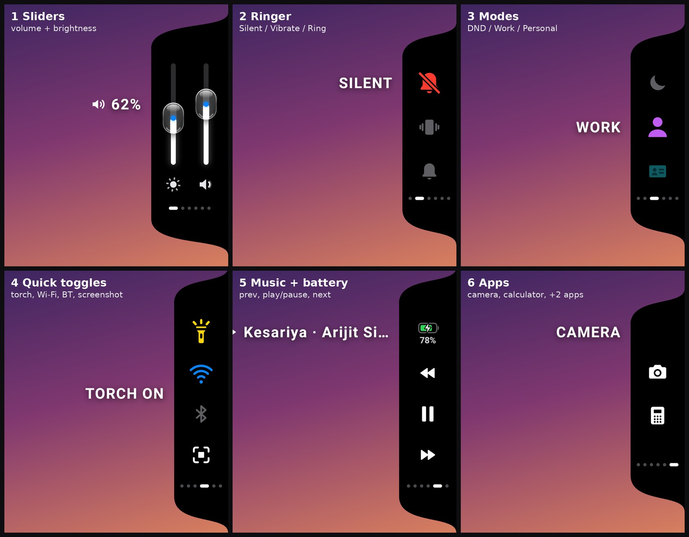
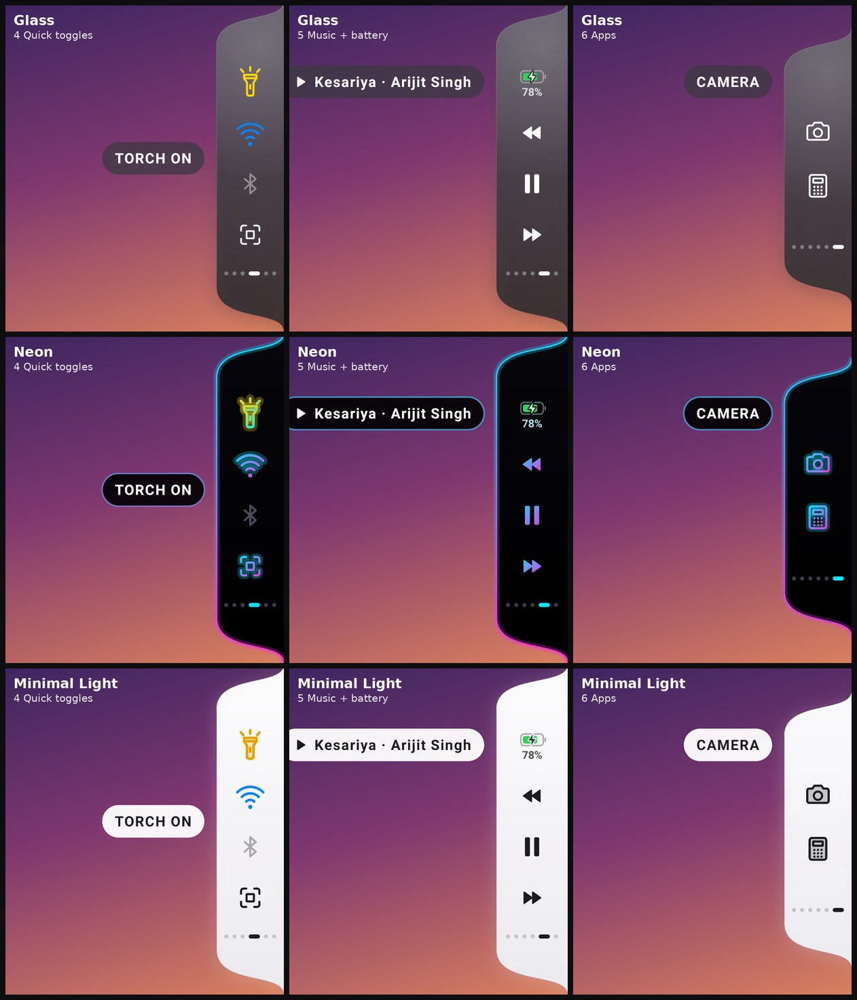
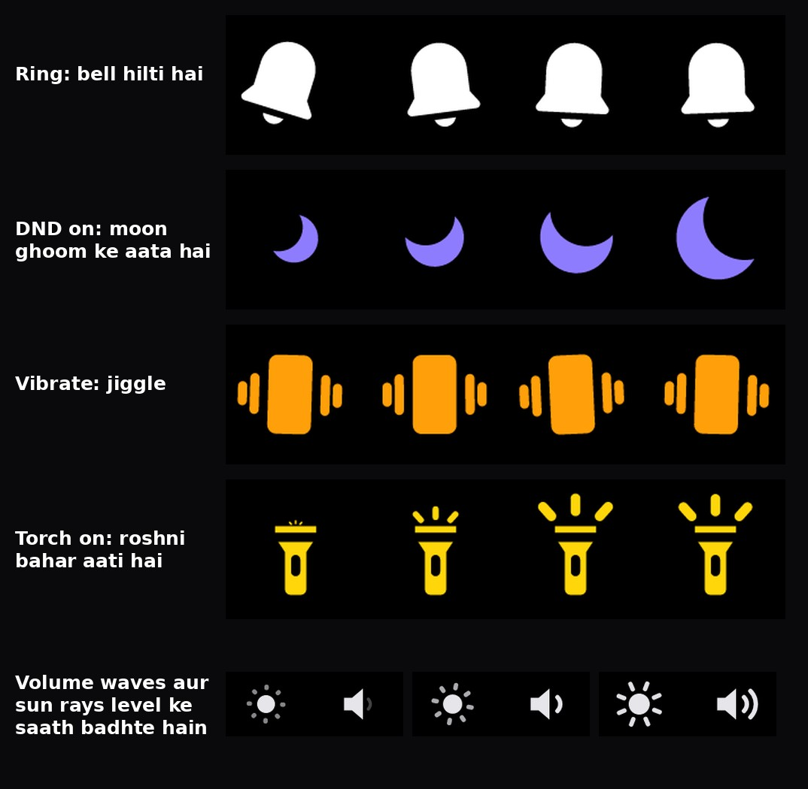
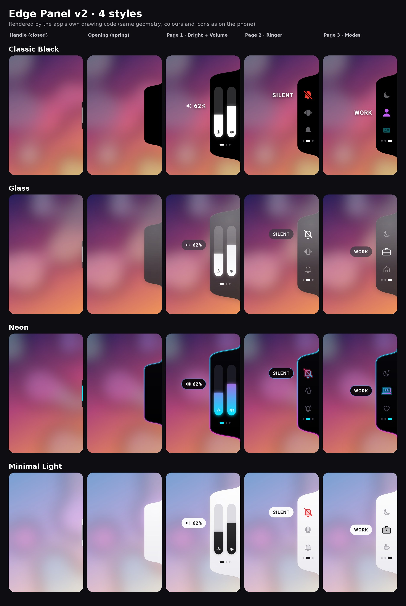
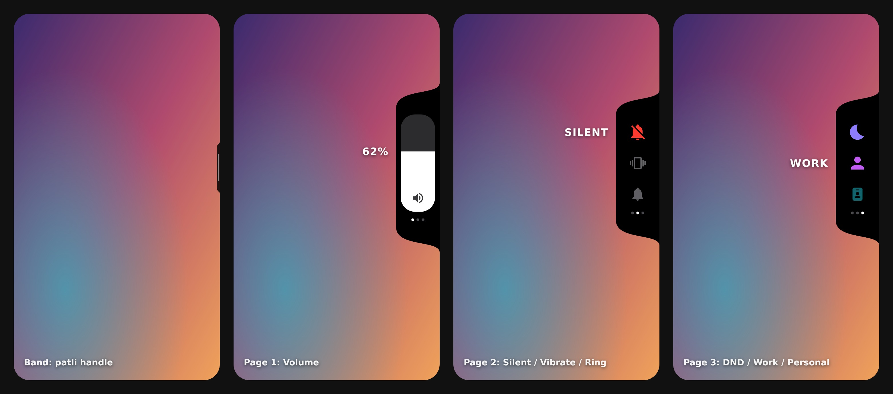

<div align="center">

# 🌊 EdgePanel

### An iOS-style, liquid-glass edge panel for Android

Volume · Brightness · Ringer · Do Not Disturb · Torch · Music · Battery · Quick apps, one swipe from the edge of your screen.

<p>
  
  
  
  
</p>

<a href="https://github.com/nitixhhh/EdgePanel/raw/main/apk/EdgePanel_v3.apk">
  
</a>

<br><br>



</div>

---

## ✨ Features

- 🫧 **Liquid-glass sliders**: slim volume and brightness tracks with a glossy glass capsule thumb (lens, highlight, rim and soft shadow) that squashes and stretches with your drag and springs back
- 📑 **6 pages**: Sliders · Ringer · Modes · Quick toggles · Music + Battery · Apps, each one can be turned on/off and reordered
- 🎨 **4 themes**: Classic Black, Glass, Neon and Minimal Light, each with its own hand-made vector icon set
- 🎯 **Accent picker**: choose the accent colour per theme, applied live
- 🌀 **iOS-like springs**: open, close, paging, sliders and labels all run on interruptible spring physics (AndroidX DynamicAnimation) with velocity hand-off
- 🔔 **Animated icons**: the bell shakes, the moon swings in, speaker waves grow with volume, sun rays grow with brightness, Work/Personal pop
- 📳 **Haptics & sounds**: rich `VibrationEffect.Composition` haptics (with fallbacks) and 14 small synthesized sound effects; both can be switched off
- 👆 **Drag-to-open handle**: grab the thin handle and pull inward, the panel follows your finger (or just tap it)
- ↔️ **Left or right edge**, adjustable handle height, start on boot
- 🌗 **Gooey edge shape**: the panel bulges out of the screen edge with smooth concave bezier fillets

## 📱 Pages

| # | Page | What it does |
|:-:|------|--------------|
| 1 | **Sliders** | Media volume + screen brightness (perceptual gamma curve) |
| 2 | **Ringer** | Silent / Vibrate / Ring with a floating label |
| 3 | **Modes** | Do Not Disturb, plus Work and Personal sound presets |
| 4 | **Quick toggles** | Flashlight, Wi-Fi, Bluetooth, Screenshot |
| 5 | **Music + Battery** | Previous / Play-Pause / Next, battery % with charging state |
| 6 | **Apps** | Camera, Calculator and up to 2 apps of your choice |

<div align="center">
  
</div>

## 🖼️ Screenshots

<div align="center">
  
  
</div>

<details>
<summary><b>Earlier versions</b></summary>
<br>

**v2: four themes**



**v1: the first panel**



</details>

> Screenshots are rendered from the app's own drawing code.

---

## ⬇️ Download & Install

1. Download **[EdgePanel_v3.apk](https://github.com/nitixhhh/EdgePanel/raw/main/apk/EdgePanel_v3.apk)** (also listed on the [Releases](https://github.com/nitixhhh/EdgePanel/releases) page).
2. Open it on your phone and allow **Install from unknown sources** for your browser / file manager.
3. If Play Protect warns you, tap **More details → Install anyway** (the app isn't from the Play Store).
4. Open **Edge Panel** and grant the permissions from the setup screen:

| Permission | Why |
|------------|-----|
| **Display over other apps** | Draws the handle and the panel on top of other apps (required) |
| **Do Not Disturb access** | DND toggle and the Work / Personal presets |
| **Modify system settings** | Brightness slider |
| **Notifications** | The foreground-service notification (Android 13+) |
| **Accessibility** *(optional)* | Only for the Screenshot button, nothing on screen is read |
| **Notification access** *(optional)* | Shows the current song title on the music page |

5. Tap **Start panel**, then drag the handle inward from the screen edge.

> **Android 13+ "Restricted setting":** sideloaded apps can't enable Accessibility / Notification access right away. Go to **App info → ⋮ → Allow restricted settings**, then turn it on.
>
> **Panel disappears?** Set battery usage for Edge Panel to **No restrictions** (on Xiaomi / Realme / Vivo / Oppo also enable **Autostart**).

## 🕹️ How to use

- **Open**: drag the handle inward, or tap it
- **Change page**: swipe up/down anywhere on the panel, or tap the dots
- **Sliders**: drag slowly on a slider to adjust it, flick quickly to change page
- **Close**: tap anywhere outside the panel

---

## 🛠️ Tech Stack

- **Kotlin**, Android SDK 34 (minSdk 26 / Android 8.0)
- **AndroidX DynamicAnimation**: `SpringAnimation` / `SpringForce` for every motion
- Custom `View` drawing on `Canvas` with `Path` + cubic beziers, no allocations in `onDraw`
- `WindowManager` overlays (`TYPE_APPLICATION_OVERLAY`) in a `specialUse` foreground service
- `SoundPool` for sound effects, `VibrationEffect.Composition` for haptics
- `AudioManager`, `NotificationManager`, `Settings.System`, `CameraManager`, `AccessibilityService`
- **Robolectric** + JUnit tests (gestures, drag-to-open, jump-free close, rendering)

## 🧱 Build from source

Requirements: **JDK 17** and the **Android SDK** (platform 34, build-tools 34).

```bash
git clone https://github.com/nitixhhh/EdgePanel.git
cd EdgePanel
echo "sdk.dir=/path/to/Android/Sdk" > local.properties   # or set ANDROID_HOME

./gradlew assembleDebug          # → app/build/outputs/apk/debug/app-debug.apk
./gradlew testDebugUnitTest      # Robolectric unit tests
./gradlew lintDebug              # lint
```

Or open the folder in Android Studio and press **Run**.

### Project structure

```text
app/src/main/java/.../edgepanel/
├── EdgePanelService.kt   # foreground service, overlay windows (handle + panel)
├── EdgePanelView.kt      # panel shape, pages, gestures, springs, sliders, icons
├── Themes.kt             # 4 themes + vector icon sets
├── ExtraIcons.kt         # icons for the widget pages (generated from SVG paths)
├── Feedback.kt           # sound effects + haptics
├── SoundControl.kt       # volume, ringer, DND, Work/Personal presets
├── BrightnessControl.kt  # brightness with gamma mapping
├── Widgets.kt            # torch, music, battery, Wi-Fi/Bluetooth, apps, screenshot
├── Prefs.kt              # settings and page order
├── MainActivity.kt       # setup screen
└── BootReceiver.kt       # start on boot
tools/                    # icon + sound generators (Python)
```

---

## 🗺️ Version history

| Version | Highlights |
|---------|------------|
| **[v3.0](https://github.com/nitixhhh/EdgePanel/releases/tag/v3.0)** | Liquid-glass sliders, 6 pages (torch, Wi-Fi, Bluetooth, screenshot, music, battery, apps), animated icons, sounds + haptics, page manager, drag-to-open fix, jump-free close |
| **[v2.0](https://github.com/nitixhhh/EdgePanel/releases/tag/v2.0)** | iOS-style spring physics, interactive paging, slim volume pill, brightness slider, 4 themes with custom icons, accent picker |
| **[v1.0](https://github.com/nitixhhh/EdgePanel/releases/tag/v1.0)** | First panel: gooey edge shape, volume, Silent/Vibrate/Ring, DND + Work/Personal presets |

The git history follows the same steps (tags `v1.0` → `v2.0` → `v3.0`). Full details in [CHANGELOG.md](CHANGELOG.md).

## ⚠️ Limitations

- **Wi-Fi / Bluetooth** can't be switched by apps on Android 10+, so those tiles open the system Internet panel and Bluetooth settings.
- **Work / Personal** are sound presets (Work = vibrate + DND priority + lower media volume), not Android work profiles.
- **Screenshot** needs Android 9+ and the accessibility service enabled.
- **Glass theme** uses gradients, since real blur isn't available to overlay windows.
- **Sounds** follow the system-sounds volume, so they are muted in Silent mode.
- While the panel is open, its window blocks touches behind it; tap outside to close.
- Some OEM back gestures can compete with the edge swipe; lowering back-gesture sensitivity on that side helps.
- The APK is debug-signed (not on the Play Store).

## 📄 License

[MIT](LICENSE) © 2026 Nitish Yadav

<div align="center">
<br>

Made with ❤️ by **[Nitish Yadav](https://github.com/nitixhhh)** · ⭐ Star the repo if you like it!

</div>
